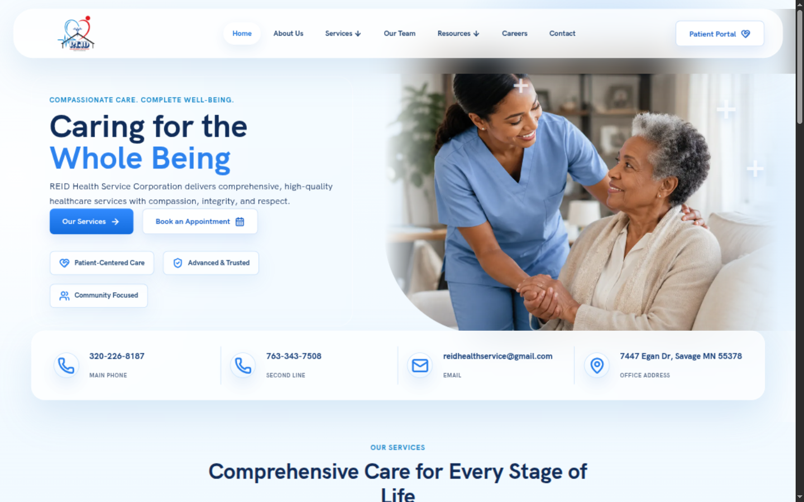
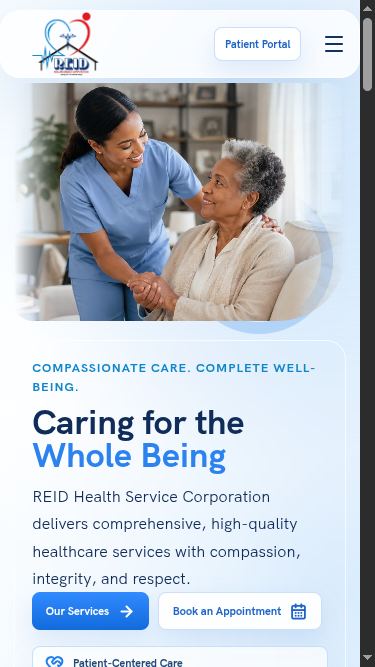
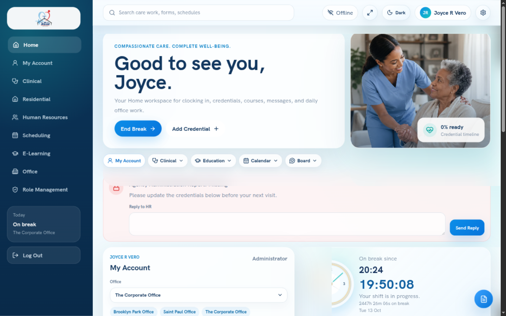

# Reid Health

**Digital workflows for healthcare and care operations**

Reid Health is a role-based healthcare operations platform for teams coordinating clinical services, residential and community care, staff, and administration. It brings related work areas into one application so that care and operations teams can move between the tasks their role requires.

## Product workspaces

- **Clinical** supports patient-related and service workflows.
- **Residential and community care** organize day-to-day service delivery.
- **Scheduling** helps coordinate staff calendars and coverage.
- **Human resources** supports workforce records and administration.
- **E-learning** manages programs, courses, grades, and training records.
- **Office, finance, and billing areas** support administrative work.
- **Reporting and administration** give authorized users tools for operational oversight.

The interface is organized around role-aware navigation and workspaces. This helps teams reach relevant lists, records, forms, calendars, documents, and follow-up actions without turning every role into the same general dashboard. Workflows can bring related client, staff, service, and scheduling information together while keeping each workspace focused on its job.

A user may move from an operational queue to a record, complete a form, review the result, and return to the related schedule or team workflow. Training administration covers course catalogs and learner progress, while workforce areas support staff and schedule tasks. The modules are connected through shared application navigation but remain focused on their own workflows.

## Engineering

The web application uses Next.js and TypeScript, with Supabase and PostgreSQL for authentication, data, file storage, and realtime features. Server-side identity checks and data-access policies are part of the application boundary. The project uses reusable interface components and shared layout patterns so that clinical, staffing, and administrative screens behave consistently while serving different roles.

The development process includes unit and workflow tests, along with responsive checks for desktop, tablet, and mobile layouts. Documents and form-driven processes are designed to preserve preview and print workflows where those are part of the task.

## Privacy and access

Healthcare software must protect patient and staff information. The staff workspace screenshot below uses a test account and test data, not a real staff member or patient. Sensitive reads and writes should follow the application's authorization rules and the user's role rather than relying on a visible navigation link alone.

## Technology

Next.js, TypeScript, Supabase, PostgreSQL, Playwright, and Vitest.

## Screenshots

The screenshots show the public website on desktop and mobile, along with the staff workspace using test data.

### Public website

### Staff workspace

## This repository

This is a public project summary with interface screenshots using test data. It does not contain real patient or staff records, private source code, or credentials.

[Explore AceNetics](https://acenetics.dev)
